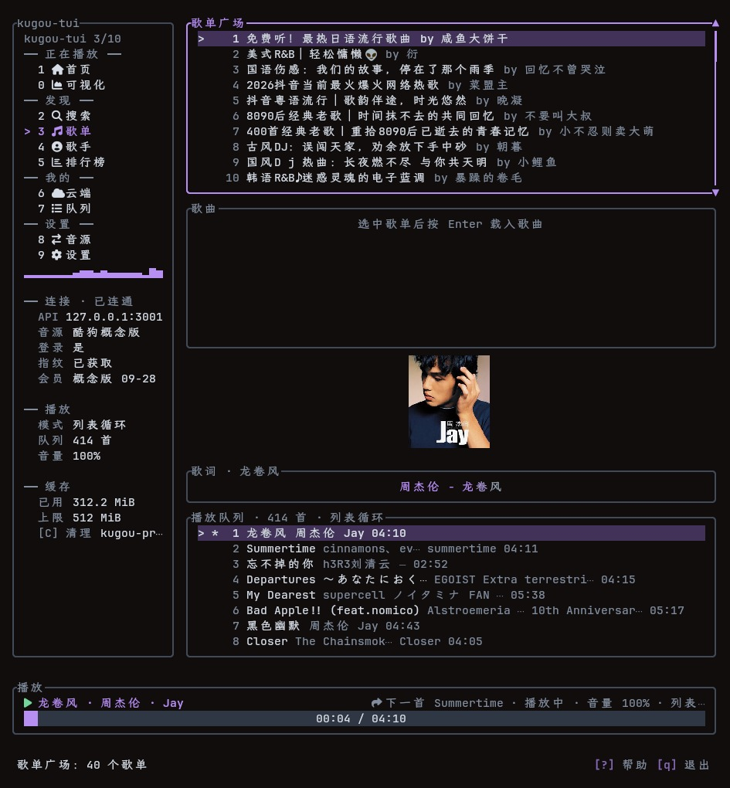

# kugou-tui

**Listen to Kugou in your terminal: per-character lyrics, real spectrum, a single binary at ~19 MiB resident.**

**English** | [中文](README.zh-CN.md)




*A Kugou player in the terminal. No window, no ads, no recommendation feed: press `2` to search, `Enter` to play, `L` to scan a QR code and pull in your cloud playlists.*

## What it is

A terminal music player for Kugou. It does one thing: **find a song, play it, and render the lyrics and spectrum well.**

1. **Per-character lyrics** — parses the per-character timestamps in Kugou's KRC format and interpolates each character's own progress, with gradient transitions on boundary characters. Not the "whole line lights up at once" behavior of LRC.
2. **Real spectrum** — FFT over actual samples captured on the audio thread, log-spaced across 40 Hz–16 kHz.
3. **Kugou catalog + cloud playlists** — search and play without local files; playlist plaza, artists, rankings, and personal cloud playlists; the login QR code is drawn directly in the terminal.

## Install

The interface is **embedded in the binary** (pure Rust); the default path needs no Node.js. Two backends can be switched at any time:

| | `--api native` (default, embedded) | `--api node` (fallback) |
|---|---|---|
| Needs Node.js | **No** | Yes, ≥ 12 |
| Resident memory | ~19 MiB (single process) | ~19 MiB for this app **+ 42–67 MiB for a separate node service** |
| Coverage | Full Kugou standard / concept editions | Same, plus the transport layer for Netease and Soda sources |

> **The default backend is `native`**: Kugou's interface is implemented in-process, so it works as soon as you install it, with no Node.js. To switch back to the Node service (self-hosted, running on another machine, or to compare implementations), add `--api node` or set `api_backend = "node"` in the config file.

**cargo** (recommended):

```bash
cargo install kugou-tui
kugou-tui
```

The embedded backend is ready on startup, with no "prepare the service on first run" step. If you want the Node fallback (or the Netease/Soda sources), the first run prepares and launches the service automatically (download + dependency install, ~30 s), and every later startup reuses it. To do that step ahead of time: `kugou-tui --api-start`; to manage the service yourself: `--no-api-start`.

**To build a binary that never contains the Node bootstrap code:**

```bash
cargo build --release --no-default-features
```

With the `node-bootstrap` feature off, the bootstrap code (port probing, downloading KuGouMusicApi, `npm install`, spawning `node app.js`) is excluded from compilation entirely and is absent from the binary. `--api node` then fails with an explicit "this feature was disabled at build time" error instead of an ambiguous connection failure. The size difference is about 0.06 MiB (see [docs/DESIGN.md](docs/DESIGN.md)).

**Prebuilt packages**: [Releases](https://github.com/sijin-xb/kugou-tui/releases) has all three platforms, bundled with scripts and all documentation.

```bash
# Linux
tar xzf kugou-tui-<version>-x86_64-unknown-linux-gnu.tar.gz
cd kugou-tui-<version>-x86_64-unknown-linux-gnu
./scripts/kugou-tui --api native      # embedded backend, no Node
./scripts/kugou-api-install kugou     # only if you intend to use the --api node fallback
```

```powershell
# Windows
Expand-Archive kugou-tui-<version>-x86_64-pc-windows-msvc.zip -DestinationPath .
cd kugou-tui-<version>-x86_64-pc-windows-msvc
.\scripts\kugou-tui.ps1 --api native
.\scripts\kugou-api-install.ps1       # only for the --api node fallback
```

**From source**:

| Platform | Prerequisites |
|---|---|
| Linux | Rust 1.90+, `alsa-lib` development headers + `pkg-config` |
| Windows | Rust 1.90+, MSVC toolchain (no CMake / NASM / OpenSSL) |
| macOS | Rust 1.90+, Xcode command-line tools (not used long-term on real hardware) |

```bash
git clone https://github.com/sijin-xb/kugou-tui.git
cd kugou-tui && cargo build --release
```

Launcher scripts, the AUR package, the Netease source, and per-platform prerequisites: **[docs/INSTALL.md](docs/INSTALL.md)**. Node.js is only a prerequisite for the `--api node` fallback; the embedded backend never touches it.

## Quick start

```bash
kugou-tui
```

Press `3` to open the playlist plaza, `Enter` to open a playlist, move the cursor, `Enter` to play. No login is needed to browse and play; search and cloud playlists require it (press `L` to scan the QR code).

## Features

| Category | Capability |
|---|---|
| Browse | Playlist plaza, artist list (filterable by region), rankings, personal cloud playlists |
| Search | Single-track search; `M` loads more |
| Playback | Play/pause, next/previous, ±5 s seek, volume, mute; sequential / repeat-all / repeat-one / shuffle |
| Lyrics | Per-character highlight (KRC), translations and transliterations, centered scrolling, line cross-fade, click a line to seek, ±100 ms offset |
| Visualizer | Real spectrum: FFT + log-spaced bands |
| Queue | Append (`a`), play next (`i`), add whole list (`A`), remove (`x`), clear (`X`) |
| Cloud playlists | Favorite a track (`s`), sync the whole queue (`S`), add/remove playlists (`N` / `D`) |
| Login | In-app QR scan (`L`); the QR code is drawn in the terminal |
| Desktop integration | MPRIS (`playerctl`-controllable) + system tray (menu / wheel volume / icon dims with state); **Linux desktops only** |
| Input and appearance | Keyboard + mouse; 6 themes (truecolor and 16-color variants); audio cached to disk with LRU eviction |

Full key list in [KEYBINDINGS.md](KEYBINDINGS.md); everything else in [docs/USER_GUIDE.md](docs/USER_GUIDE.md).

## How it compares to cmus / mpd

|  | **kugou-tui** | cmus | mpd + ncmpcpp |
|---|---|---|---|
| **Catalog** | **Kugou's online catalog**: search and play, no local files needed | Local files only | Local files only |
| **Per-character lyrics** | **Yes**: KRC per-character timestamps, gradient highlight advancing per character | Whole-line LRC | Whole-line LRC |
| **Spectrum** | **Built in**, zero config | None | Yes, but requires configuring mpd's fifo output |
| **Cloud playlists** | **Yes**: QR login inside the terminal | No | No |
| **Resident memory** | ~19 MiB (`--api native`, single process, measured locally) | 10–25 MiB typical | 15–30 MiB typical |
| **Shape** | Single process, single binary (~11.7 MiB) | Single process | Client / server split |
| **Self-hosted service needed** | **No** (with `--api native` the interface is in-process; only the `--api node` fallback uses a local service) | No | Yes (mpd) |

> The memory row is measured locally (release build, 112×34 terminal, `--no-tray`, reading `VmRSS` from `/proc/<pid>/status`); the method and breakdown are in [docs/DESIGN.md](docs/DESIGN.md). The cmus / mpd rows are community-typical figures, not measured here. Compared with the pre-migration version, `--api native` removes the separate Node process (which alone took 42–67 MiB) at a cost of ~0.4 MiB to the program itself.
>
> In one line: **cmus / mpd play what you have; kugou-tui plays what you want to hear.**

## What it depends on

**`--api native` (embedded backend): the program is the interface implementation.** Search, stream resolution, lyric decryption (KRC), device fingerprinting, QR login, and cloud-playlist reads/writes are all pure Rust in the same process — no subprocesses, no Node.js on the machine. The request URLs, headers, parameter order, and signature algorithm are ported point-by-point from upstream [KuGouMusicApi](https://github.com/MakcRe/KuGouMusicApi) and covered by known-answer tests (KAT).

**`--api node` (fallback):** search, stream resolution, lyrics, and cloud playlists go through a local third-party service [KuGouMusicApi](https://github.com/MakcRe/KuGouMusicApi) (a separate Node.js repo). On startup it probes the port once; if nothing is there it prepares and launches the service, and stops only the instance it started — so apart from Node.js you need to deploy nothing by hand. To do it manually, or to deploy the Netease service, see [docs/INSTALL.md](docs/INSTALL.md#deploying-the-third-party-api-service).

The Node fallback's bootstrap code can be removed entirely with `--no-default-features` (see [Install](#install)).

## Embedded WebSocket service

Both `--api native` and `--api node` open a WebSocket service on startup so third-party clients can read playback state and lyrics and control playback (protocol compatible with [MoeKoeMusic](https://github.com/MoeKoeMusic/MoeKoeMusic); docs at [music.moekoe.cn/zh-CN/websocket-api.html](https://music.moekoe.cn/zh-CN/websocket-api.html)):

| Item | Value |
|---|---|
| Default address | `ws://127.0.0.1:6520/` |
| Binding | **`127.0.0.1` only**; non-loopback connections are refused |
| Disable | `--no-ws`, or `ws = false` in the config |
| Change port | `--ws-port <PORT>`, or `ws_port = 6520` in the config |

The service pushes `welcome` / `lyrics` / `playerState` and accepts `control` commands (`toggle` / `next` / `prev`). The handshake validates `Origin`: cross-site handshakes carrying a browser `Origin` are rejected (403), while local clients without an `Origin` are allowed. Inbound messages and a single frame are capped at 64 KiB.

## Documentation

| Document | Contents |
|---|---|
| [docs/INSTALL.md](docs/INSTALL.md) | Requirements, per-platform install paths, API service deployment, launcher scripts and environment variables |
| [KEYBINDINGS.md](KEYBINDINGS.md) | All shortcuts, mouse actions, track context menu |
| [docs/USER_GUIDE.md](docs/USER_GUIDE.md) | UI layout, source configuration, playback queue, login and cloud playlists, desktop integration |
| [docs/CONFIGURATION.md](docs/CONFIGURATION.md) | Command-line arguments, every config file item, session persistence |
| [docs/FAQ.md](docs/FAQ.md) | Common questions and troubleshooting |
| [docs/DESIGN.md](docs/DESIGN.md) | Thread model, streaming playback, low resource footprint, interface adaptation (with measurement methodology) |
| [docs/MAINTENANCE.md](docs/MAINTENANCE.md) | Maintainer handbook: module map, risk points, known pitfalls, how to verify changes |
| [docs/LICENSES.md](docs/LICENSES.md) | Third-party dependency license analysis |
| [docs/RELEASE.md](docs/RELEASE.md) | Release process, artifact list, version and tag rules |
| [CHANGELOG.md](CHANGELOG.md) | Changelog |

## License and disclaimer

[MIT](LICENSE) © 2026 kugou-tui contributors.

**A self-use tool for learning and technical research only.** It does not provide, host, or distribute any music content. Respect music copyright and support legitimate services; accessing unofficial interfaces may violate Kugou's terms of service, at your own risk. Full terms in [docs/DISCLAIMER.md](docs/DISCLAIMER.md).

## Acknowledgements

- [KuGouMusicApi](https://github.com/MakcRe/KuGouMusicApi) — the source of this project's interface implementation.
- [MoeKoeMusic](https://github.com/MoeKoeMusic/MoeKoeMusic) — design reference for lyric parsing, playback modes, and cloud-playlist sync; the two-step "claim daily concept-edition VIP" flow also comes from it.
- [libresoda](https://github.com/sodahub-org/libresoda) — the Soda Music data layer (`crates/libresoda`), the same library the official SodaM client uses.
- [ratatui](https://github.com/ratatui/ratatui) / [rodio](https://github.com/RustAudio/rodio) / [tokio](https://github.com/tokio-rs/tokio) / [ratatui-image](https://github.com/benjajaja/ratatui-image) — UI, audio, async runtime, and cover rendering.
