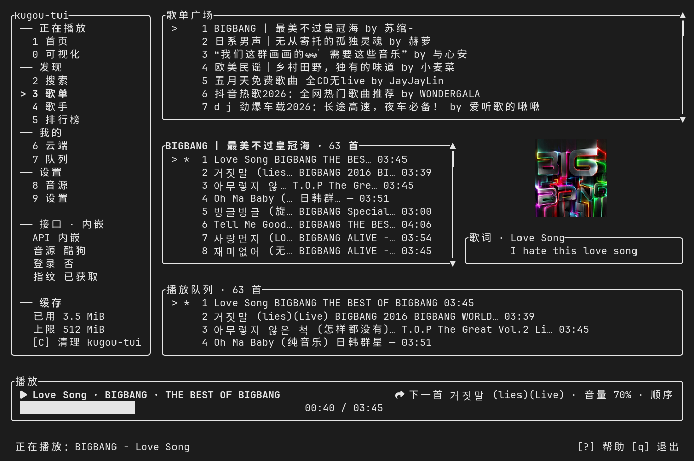

# kugou-tui

在终端里听酷狗：逐字歌词、真实频谱、单进程二进制，播放时常驻内存约 17 MiB。




酷狗接口内嵌在二进制里，默认 `--api native` 不需要 Node.js；只有 `--api node` 回退和网易云音源才要本机跑一份第三方接口服务。

## 安装

```bash
cargo install kugou-tui
kugou-tui
```

从源码构建就 `git clone` 之后 `cargo build --release`，产物约 11.7 MiB。需要 Rust 1.90+；Linux 另需 `alsa-lib` 开发头文件和 `pkg-config`（Debian/Ubuntu 是 `libasound2-dev pkg-config`，Arch 是 `alsa-lib`），Windows 只需 MSVC 工具链，macOS 只需 Xcode 命令行工具。

想编出一个彻底不含 Node 引导代码的二进制（没有下载器、没有 `npm` 调用），用 `cargo build --release --no-default-features`。此时 `--api node` 会直接报「该 feature 已在构建时禁用」。

Release 页提供 Linux x86_64、Windows x86_64、macOS arm64 三个包，内含二进制、`scripts/`、`README.md`、`CHANGELOG.md`、`LICENSE`。Intel Mac 请从源码构建。Windows 把下面的 `./scripts/` 换成 `.\scripts\` 下的 `.ps1`。

```bash
tar xzf kugou-tui-<版本>-x86_64-unknown-linux-gnu.tar.gz
cd kugou-tui-<版本>-x86_64-unknown-linux-gnu
./scripts/kugou-tui
```

`scripts/kugou-tui` 是启动器：默认 `--api native` 时直接进播放器。只有切到 `--api node` 或网易云音源，它才会准备并拉起本机接口服务。

## 快速开始

按 `2` 搜索，`Enter` 播放，按 `L` 扫码登录拉云端歌单。不登录也能听，云端歌单与收藏需要账号。

## 按键

输入框获得焦点时字母键只输入文本，`Esc` 退出输入模式。

| 按键 | 动作 |
|---|---|
| `1`–`9` `0` | 主页 搜索 歌单 歌手 排行榜 云端 队列 音源 设置 可视化 |
| `Tab` `S-Tab` | 切换焦点区域 |
| `j` `k` `↑` `↓` | 上下移动（首页与可视化页改为切歌） |
| `g` `G` `PgUp` `PgDn` | 首行 / 末行 · 翻页 |
| `Enter` `Esc` | 播放 / 进入 · 返回 |
| `Space` `n` `p` | 播放暂停 · 下一首 · 上一首 |
| `←` `→` | 后退 / 前进 5 秒（设置页里改选中项） |
| `+` `-` `m` | 音量 ±5% · 静音 |
| `r` `y` `W` | 循环模式 · 切音质 · 下载当前曲目 |
| `l` `[` `]` | 歌词面板 · 延迟 / 提前 100 ms |
| `a` `i` `A` | 加入队列 · 插播下一首 · 整段加入 |
| `x` `X` `o` | 从队列移除 · 清空 · 升降序 |
| `s` `S` `d` `D` `N` | 收藏 · 同步队列 · 移除 · 删歌单 · 新建 |
| `L` `V` `C` | 扫码登录 · 领当日概念版 VIP · 清音频缓存 |
| `/` `R` `M` `b` `c` `f` | 搜索框 · 刷新 · 加载更多 · 排行榜 · 云端歌单 · 歌手筛选 |
| `,` `v` `\` | 设置页 · 切换音源 · 显示/隐藏侧边栏 |
| `?` `F1` `q` `Q` | 帮助面板（40 条） · 退出 / 强制退出 |

`;` 或鼠标右键打开歌曲菜单。双击列表行等同 `Enter`，滚轮移动选中项，单击进度条或歌词行跳转，设置页里 `←` `→` 改值。自定义快捷键写配置文件里的 `[keymap]`。

## 配置

配置文件在 `~/.config/kugou-tui/config.toml`（Windows `%APPDATA%\kugou-tui\`，macOS `~/Library/Application Support/kugou-tui/`），`--print-config` 打印当前生效值。

常用项：`api_backend`（`native` / `node`）、`api_auto_start`、`api_dir`、`volume`（0–1）、`quality`（`128` / `320` / `flac` / `high`）、`playback_mode`（`sequential` / `repeat_all` / `repeat_one` / `shuffle`）、`cache_dir`、`cache_limit_mib`（默认 512，`0` 不限制）、`page_size`（默认 30）、`tick_ms`（默认 200）、`audio_device`、`download_dir`、`theme`、`basic_color`、`lite_mode`（关封面与频谱，刷新降到 5fps）、`lyric_offset_ms`、`cover_fill`、`qr_aspect`、`tray`、`ws`、`ws_port`（默认 6520）、`proxy`、`[keymap]`。命令行参数与配置项一一对应，`--help` 有完整列表。

`[keymap]` 的键是动作名（`quit`、`play_pause`、`open_search` 等，完整列表见 `src/keymap.rs` 的 `REBINDABLE`），值是按键写法（`Q`、`ctrl+n`、`f1`）。

## 音源

`8` 进音源页：`Enter` 启用或禁用，`E` 设为默认，`J` `K` 调优先级。

- **酷狗概念版**：接口与标准版不同，登录态不通用，切过去要按 `L` 重新扫码。`V` 领当日 VIP，登录后和切音源时会自动领一次。
- **网易云**：需要本机跑一份 NeteaseCloudMusicApi（`./scripts/kugou-api-install netease`，端口 3002）。
- **汽水音乐**：直连公网，不需要本机服务。扫码登录走 libresoda 内置的 CDP 签名页，要求本机有 Chrome / Chromium / Edge；也可以 `--sodam-cookie` 手填 cookie。VIP 整曲依赖应用签名，默认用上游公共签名服务，`--sodam-signer-url` 可指向自建实例，填 `none` 关闭签名（只剩试听与免费曲目）。

`--api node` 回退会自行下载固定提交的 KuGouMusicApi、装依赖、拉起服务（首次需要几十秒，`npm install` 有超时上限），退出时随程序停止。想自己管就设 `api_auto_start = false`，或用 `./scripts/kugou-api start|stop|restart|status|logs`。想提前把首次安装花掉、之后秒开，先跑一次 `kugou-tui --api-start`，它拉起的服务留在后台，用 `--api-stop` 停掉。

## 排障

- 内存只涨不降：`KUGOU_TUI_MEM_TRACE=1 kugou-tui`，日志每 5 秒一行 `[mem] RSS … KiB，流式任务 N，队列 N，命中区 N，曲目 …`。流式任务长期大于 1 说明下载任务没被摘除。日志在 `~/.cache/kugou-tui/kugou-tui.log`（权限 0600），`KUGOU_TUI_DEBUG=1` 打开调试输出。
- 搜不到歌：按 `L` 登录后重试。云端歌单、收藏与歌单广场的部分操作需要账号。
- 托盘图标不出现：需要 `org.kde.StatusNotifierWatcher`（Quickshell / waybar / KDE 都有），托盘线程每 5 秒重试注册。
- 封面是色块：终端不支持 Kitty / iTerm2 / sixel 图形协议，封面回退成半块字符画。换一个支持的终端，或开 `lite_mode` 直接不画封面。
- 中文显示成方框、图标缺失：缺中文字体或 Nerd Font。装好字体后设 `KUGOU_TUI_NERD_FONT=1` 强制启用图标字体（Windows 上默认按没有 Nerd Font 处理）。

## 开发

提交前跑 `cargo fmt --check`、`cargo clippy --all-targets -- -D warnings`、`cargo test`。发版走 `./scripts/release`。

## 许可与免责

本项目以 **AGPL-3.0-or-later** 授权，正文见 `LICENSE`。

1. **仅供个人学习与技术研究使用。** 本项目不提供、不托管、不分发任何音乐内容。
2. **接口协议与内置资源来自第三方逆向工程项目。** 内嵌的酷狗接口实现逐项对照 [KuGouMusicApi](https://github.com/MakcRe/KuGouMusicApi) 移植；汽水音源数据层取自 [sodahub-org/libresoda](https://github.com/sodahub-org/libresoda)。本项目不拥有任何音乐版权，也不对这些接口或第三方资源的可用性、稳定性或合法性负责。
3. **第三方服务合规风险。** 通过非官方接口访问酷狗可能违反其服务条款，存在账号被限制或封禁的风险。不鼓励、也不协助批量下载、分发或商业使用。
4. **版权。** 尊重音乐版权，支持正版。缓存文件请自行清理。
5. **地区与法律。** 请勿在违反当地法律法规的情况下使用；使用后果由使用者自行承担。
6. **隐私。** 登录 cookie 只存在本地配置文件里（权限 `0600`），只发往酷狗官方域名或你自己部署的接口服务。日志里的 `token` / `userid` / `dfid` / `mid` 一律脱敏，没有遥测。

感谢 [KuGouMusicApi](https://github.com/MakcRe/KuGouMusicApi)（接口实现来源）、[MoeKoeMusic](https://github.com/MoeKoeMusic/MoeKoeMusic)（歌词与歌单设计参考）、[libresoda](https://github.com/sodahub-org/libresoda)（汽水数据层）、[ratatui](https://github.com/ratatui/ratatui) / [rodio](https://github.com/RustAudio/rodio) / [tokio](https://github.com/tokio-rs/tokio) / [ratatui-image](https://github.com/benjajaja/ratatui-image)。
